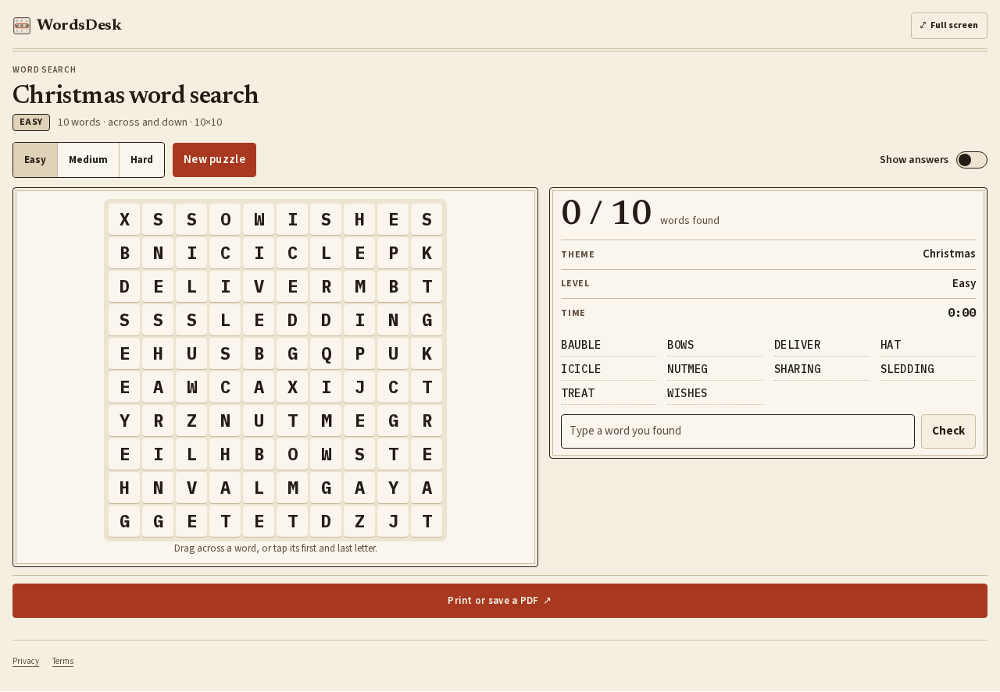
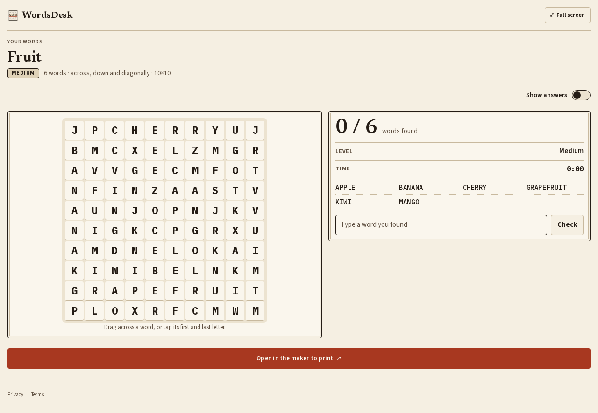
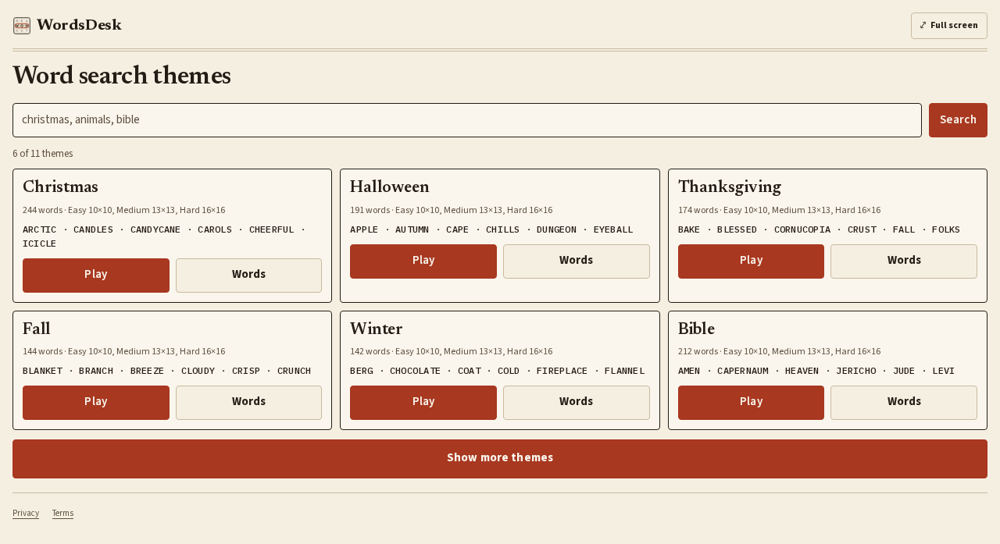

# WordsDesk MCP server


WordsDesk is a hosted, read-only [Model Context Protocol](https://modelcontextprotocol.io) server for word search puzzles. An AI assistant can use it to build a puzzle from one of 11 themes at easy, medium or hard, make one from your own words, and list the themes and their words. In hosts that support MCP Apps (ChatGPT, Claude) the puzzle is a playable grid with a timer and a Show answers switch.

- Website: https://wordsdesk.com
- MCP endpoint: `https://wordsdesk.com/api/mcp` (Streamable HTTP, no sign-in)
- Documentation: https://wordsdesk.com/app
- Official MCP Registry name: `com.wordsdesk/wordsdesk`

This repository holds the public server description, icons and connection instructions. The server itself is hosted at wordsdesk.com, so there is nothing to install or run locally.

## Tools

All tools are read-only.

| Tool | What it does |
|---|---|
| `play_word_search` | A ready puzzle from one of 11 themes at easy, medium or hard: grid, words with positions, directions, seed and a playable widget |
| `make_word_search` | A puzzle from 3 to 40 of your own words, with the words that did not fit and why |
| `list_themes` | The 11 themes with word counts, level sizes, sample words and a link to each theme page |
| `theme_words` | A theme's word list, optionally only words up to a maximum length |

- Themes: christmas, halloween, thanksgiving, fall, winter, bible, animal, math, science, 4th-of-july, kids. Kids has only the easy level.
- A `seed` repeats a puzzle; a different seed gives another one on the same theme and level.

## Connect

### ChatGPT and Claude

Add a custom connector with the URL `https://wordsdesk.com/api/mcp` and choose no authentication.

### Claude Desktop, Cursor and other MCP clients

```json
{
  "mcpServers": {
    "wordsdesk": {
      "url": "https://wordsdesk.com/api/mcp"
    }
  }
}
```

Clients that only launch local servers can connect through a bridge such as [`mcp-remote`](https://www.npmjs.com/package/mcp-remote):

```json
{
  "mcpServers": {
    "wordsdesk": {
      "command": "npx",
      "args": ["-y", "mcp-remote", "https://wordsdesk.com/api/mcp"]
    }
  }
}
```

## Try asking

- "Make me an easy Christmas word search."
- "Make a word search from these words: apple, banana, cherry, mango, kiwi, grapefruit."
- "Give me a hard animal word search."
- "Which word search themes are there?"

## On the website

- [WordsDesk word search puzzles](https://wordsdesk.com/)

## Screenshots

| Play | Make | Themes |
|---|---|---|
|  |  |  |

## Privacy and support

- Privacy: https://wordsdesk.com/privacy/
- Terms: https://wordsdesk.com/terms/
- Support: https://wordsdesk.com/contact/ or abishop1933@gmail.com

WordsDesk has no accounts. The theme, level and words sent from the chat are used to build the puzzle and are not stored by WordsDesk; the hosting provider keeps standard request logs for a short time.

To report a problem, open an issue in this repository or write to abishop1933@gmail.com.

## License

The text and icons in this repository are released under the [MIT License](LICENSE). The WordsDesk website, its content and brand are not covered by it.
